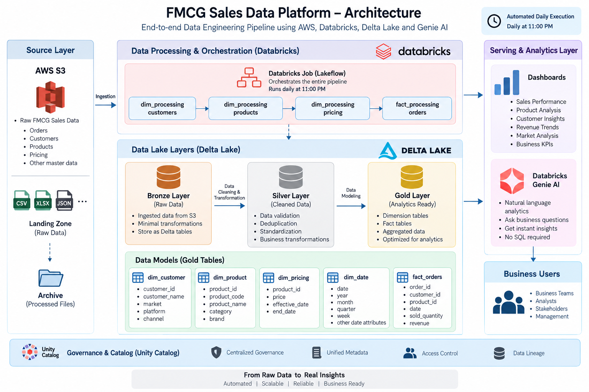
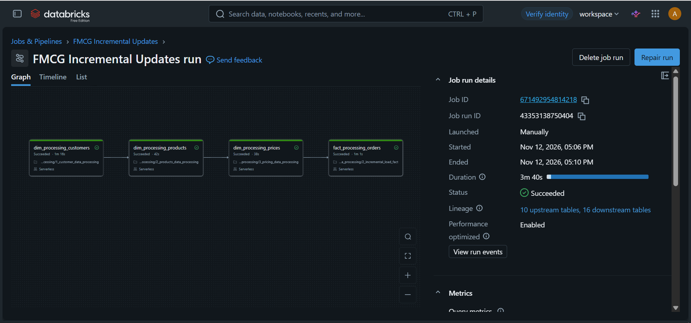
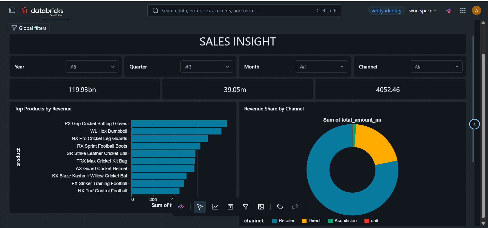
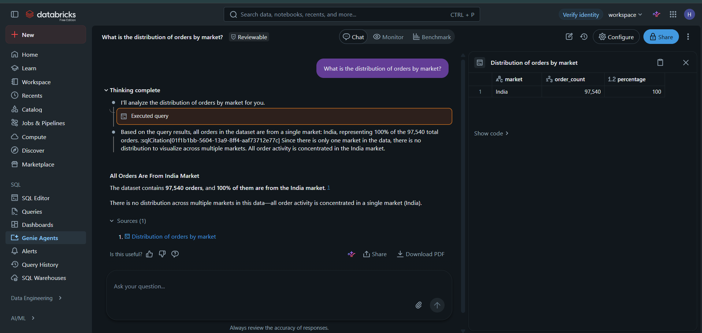

# 🛒 FMCG Sales Data Platform

An end-to-end data engineering project on **AWS S3, Databricks, PySpark, Delta Lake, and Databricks Genie**. It ingests raw FMCG sales data, refines it through a Bronze → Silver → Gold medallion pipeline, merges a child company's data into the parent company's analytics tables, and serves the results through a dashboard and natural-language analytics.

   

---

## Table of Contents

- [Overview](#overview)
- [Architecture](#architecture)
- [Screenshots](#screenshots)
- [Pipeline Details](#pipeline-details)
- [Data Model](#data-model)
- [Project Structure](#project-structure)
- [Getting Started](#getting-started)
- [Roadmap](#roadmap)
- [Author](#author)

---

## Overview

The scenario: a parent FMCG company acquires a smaller sports-nutrition business. The child company's customers, products, prices, and daily orders arrive as CSV files in S3, in a different shape and with messy data. This platform cleans that data and merges it into the parent company's Gold tables so both businesses can be analyzed together.

**What it demonstrates**

- **Medallion architecture** (Bronze, Silver, Gold) on Delta Lake with Unity Catalog schemas
- **Batch (full) load and incremental load** for the orders fact table
- **Data quality handling**: de-duplication, typo correction, multi-format date parsing, invalid ID and price fixes
- **Delta `MERGE` upserts** into the parent dimension and fact tables
- **Orchestration** with a Databricks Job running four dependent tasks
- **Serving layer** with an AI/BI dashboard and a Genie agent

## Architecture



| Layer | Role |
|-------|------|
| **Source (AWS S3)** | Raw CSVs for customers, products, gross price, and orders. Orders land in a `landing/` folder and are moved to `processed/` after ingestion. |
| **Bronze** | Raw data as ingested, plus audit columns (`read_timestamp`, `file_name`, `file_size`). |
| **Silver** | Cleaned and standardized data with business columns added. |
| **Gold** | Analytics-ready child tables (`sb_*`), merged into the parent company's dimension and fact tables. |
| **Serving** | Dashboard and Genie AI for business users. |

## Screenshots

### Orchestration: Databricks Job

The `FMCG Incremental Updates` job runs four tasks in sequence: customers, products, pricing, then orders. This run succeeded in 3m 40s on serverless compute.



### Sales Insight Dashboard

Filters for year, quarter, month, and channel, with a top products by revenue bar chart and a revenue share by channel donut chart.



### Genie AI Analytics

Business users can ask questions in plain English and get answers backed by SQL, with no query writing needed.



## Pipeline Details

### 1. Setup (`setup_folder/`)

| File | Purpose |
|------|---------|
| `setup_1.py` | Creates the `fmcg` catalog and the `bronze`, `silver`, and `gold` schemas. |
| `utilities.py` | Shared schema names, loaded by every notebook with `%run`. |
| `dim_date_table_creation.py` | Builds the monthly `dim_date` table (Jan 2024 – Dec 2025) with year, month, quarter, and a `yyyyMM` key. |

### 2. Dimension processing (`dimension_data_processing/`)

| Notebook | Key transformations |
|----------|---------------------|
| `1_customer_data_processing.py` | Drops duplicate `customer_id`s, trims names, fixes city typos (e.g. "Bengalore" → "Bengaluru"), fills missing cities from a business-provided mapping, and adds `customer`, `market`, `platform`, and `channel` columns. |
| `2_products_data_processing.py` | De-duplicates by `product_id`, fixes casing and the "Protien" spelling, derives `division` from category, extracts `variant`, generates a SHA-256 `product_code`, and replaces invalid IDs with `999999`. |
| `3_pricing_data_processing.py` | Parses `month` from four date formats, converts negative prices to positive, sets non-numeric prices to 0, joins to products for `product_code`, then keeps the latest non-zero price per product per year. |

Each notebook reads its source through the `catalog` and `data_source` widgets, writes Bronze, Silver, and Gold tables, then upserts into the parent table with Delta `MERGE`.

### 3. Fact processing (`3_fact_data_processing/`)

| Notebook | Purpose |
|----------|---------|
| `1_full_load.py` | Initial historical load of orders through Bronze, Silver, and Gold. Cleans customer IDs, strips weekday names from dates, parses multiple date formats, de-duplicates, and joins to products. |
| `2_incremental_load_fact.py` | Daily load: appends new files to Bronze, stages only the new rows, applies the same cleaning, merges into Silver and Gold, then moves files from `landing/` to `processed/`. It recalculates only the **affected months** and merges them into the parent `fact_orders` at monthly grain. Staging tables are dropped at the end. |

## Data Model

Child company tables (Gold schema): `sb_dimcustomers`, `sb_dim_products`, `sb_dim_gross_price`, `sb_fact_orders`

Parent company tables updated by `MERGE`:

| Table | Key | Updated columns |
|-------|-----|-----------------|
| `fmcg.gold.dim_customers` | `customer_code` | customer, market, platform, channel |
| `fmcg.gold.dim_products` | `product_code` | division, category, product, variant |
| `fmcg.gold.dim_gross_price` | `product_code` | price_inr, year |
| `fmcg.gold.fact_orders` | `date`, `product_code`, `customer_code` | sold_quantity (monthly) |
| `fmcg.gold.dim_date` | `date_key` | created by the setup notebook |

## Project Structure

```text
fmcg-sales-data-platform/
├── setup_folder/
│   ├── setup_1.py                       # Catalog and schema creation
│   ├── utilities.py                     # Shared schema names
│   └── dim_date_table_creation.py       # Date dimension
├── dimension_data_processing/
│   ├── 1_customer_data_processing.py
│   ├── 2_products_data_processing.py
│   └── 3_pricing_data_processing.py
├── 3_fact_data_processing/
│   ├── 1_full_load.py                   # Historical load
│   └── 2_incremental_load_fact.py       # Daily incremental load
├── docs/                                # Architecture and screenshots
└── README.md
```

## Getting Started

**Prerequisites**

- A Databricks workspace with Unity Catalog (the Free Edition works)
- An S3 bucket the workspace can read, laid out as `customers/`, `products/`, `gross_price/`, and `orders/landing` + `orders/processed`

**Steps**

1. Import the repo into your Databricks workspace under `/Workspace/consolidated_pipeline/`. The notebooks load `setup_folder/utilities` from that path with `%run`.
2. Run `setup_1.py` and `dim_date_table_creation.py`.
3. Make sure the parent tables (`dim_customers`, `dim_products`, `dim_gross_price`, `fact_orders`) exist in `fmcg.gold`, since the notebooks `MERGE` into them.
4. Update the S3 bucket name (`s3://child-comp-dp/...`) in each notebook to your own.
5. Run the notebooks in order: customers, products, pricing, then `1_full_load.py` once.
6. Create a Databricks Job with the four tasks (customers → products → pricing → incremental fact load) and schedule it daily.
7. Build a dashboard and Genie space on top of the Gold tables.

## Roadmap

- [ ] Parameterize the S3 bucket and workspace paths instead of hard-coding them
- [ ] Add data quality checks and alerting on job failures
- [ ] Replace the manual city-fix mapping with a reference table
- [ ] Add unit tests for the transformation logic
- [ ] CI/CD with Databricks Asset Bundles

## Author

**Mohammed Abdul Rahman Zaid**, aspiring Data Engineer
GitHub: [@Abdul-Rahman-Zaid](https://github.com/Abdul-Rahman-Zaid)
